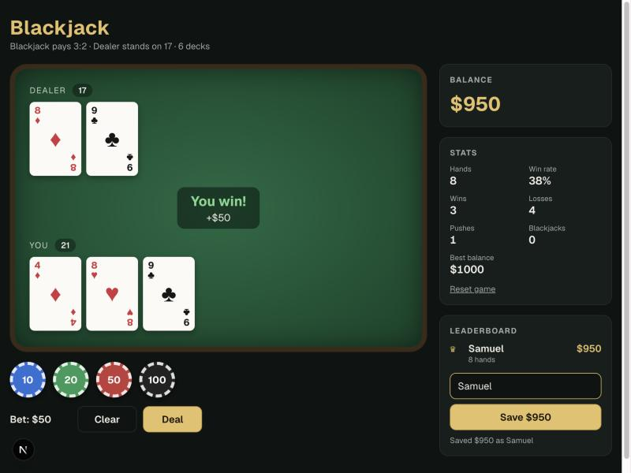

# Blackjack

Next.js-iga tehtud blackjacki mäng. Panustad žetoonidega, mängid diileri vastu ja oma parima tulemuse saad edetabelisse salvestada.



## Käivitamine

Vaja on Node.js 22.13 või uuemat, sest edetabel kasutab sisseehitatud `node:sqlite` moodulit.

```bash
npm install
npm run dev
```

Seejärel ava brauseris http://localhost:3000.

Teised käsud:

```bash
npm test        # mängu reeglite ja edetabeli kontrolli testid
npm run lint
npm run build
```

## Reeglid

- Alguses on sul $1000. Panuse valid žetoonidega 10, 20, 50 ja 100 ning vajutad **Deal**.
- **Hit** annab sulle uue kaardi ja **Stand** lõpetab sinu käigu.
- **Double** kahekordistab panuse ja annab täpselt ühe kaardi. See on lubatud ainult kahe esimese kaardiga.
- **Split** on lubatud, kui kaks esimest kaarti on sama väärtusega (nt 8+8 või K+10). Need jagatakse kaheks eraldi käeks ja teine käsi saab sama suure panuse. Splitti saab korrata kuni 4 käeni ja pärast splitti võib teha ka Double'i. Ässade splitti korral saab kumbki käsi ainult ühe kaardi juurde. Pärast splitti ei ole 21 blackjack, see maksab 1:1.
- Diiler võtab kaarte, kuni tal on vähemalt 17 punkti.
- Blackjack ehk äss ja 10-punktine kaart maksab 3:2, tavaline võit 1:1 ja viigi korral saad panuse tagasi.
- Mängitakse 6 kaardipakiga. Kui alles jääb vähem kui üks pakk, segatakse kaardid uuesti.
- Kui lahkud lehelt käe ajal, jääb panus kaotatuks nagu päris kasiinos.

### Kiirklahvid

| Klahv | Käik |
|---|---|
| `H` | Hit |
| `S` | Stand |
| `D` | Double |
| `P` | Split |

Kiirklahvid töötavad ainult sinu käigu ajal. Kui kirjutad edetabeli nimevälja, on need välja lülitatud.

## Kuidas see töötab

| Osa | Fail | Mida teeb |
|---|---|---|
| Reeglid | `lib/blackjack.js` | Puhtad funktsioonid: pakk, segamine, käe väärtus, tulemus ja väljamakse. Reacti siin pole, nii et neid saab eraldi testida. |
| Mäng | `app/components/Game.jsx` | Client Component, mis hoiab mängu olekut (`useState`): käed (splitti korral mitu), panus, saldo ja käigu faas. |
| Kaardid | `Card.jsx`, `Hand.jsx` | Kaart ja käsi koos summaga. Diileri teine kaart on sinu käigu ajal peidus. |
| Salvestus | `localStorage` | Saldo ja statistika jäävad alles ka pärast lehe värskendamist. |
| Edetabel (API) | `app/api/leaderboard/route.js` | `GET` tagastab 10 parimat tulemust ja `POST` salvestab uue. |
| Andmebaas | `lib/db.js` | SQLite fail `data/blackjack.db`, mis ei ole gitis. |
| Kontroll | `lib/score.js` | Server kontrollib nime, saldot ja käte arvu, sest brauserist tulevat infot ei saa usaldada. |

### Miks mäng renderdatakse ainult brauseris?

Saldo loetakse `localStorage`-ist, mida serveris ei ole. Seepärast laeb `GameLoader.jsx` mängu `dynamic(..., { ssr: false })` abil ainult brauseris.

### Miks API kutsub `await connection()`?

Next.js 16 püüab `GET` route'id buildi ajal valmis renderdada. SQLite päring on sünkroonne, nii et ilma `connection()` kutseta jääks edetabel buildi aegsesse seisu kinni.

## Teadaolev piirang

Saldo arvutatakse brauseris, seega saab osav kasutaja edetabelisse saata võltsitud tulemuse. Server lubab ainult mõistlikke väärtusi, aga täielikult turvaline oleks see alles siis, kui kogu mänguloogika jookseks serveris. See on järgmine samm, kui projekti edasi arendada.

## Arendus

Iga osa tehti eraldi feature-harus ja lisati `main`-i pull requestiga:

1. `feat/game-logic`: reeglid ja testid
2. `feat/table-ui`: mängulaud, panused ja statistika
3. `feat/leaderboard`: edetabel, API ja SQLite
4. `docs/readme`: see fail
5. `feat/split`: split ehk paari jagamine kaheks käeks
6. `feat/hotkeys`: kiirklahvid H, S, D ja P

Projekt on tehtud [Claude Code](https://claude.com/claude-code) abil.
